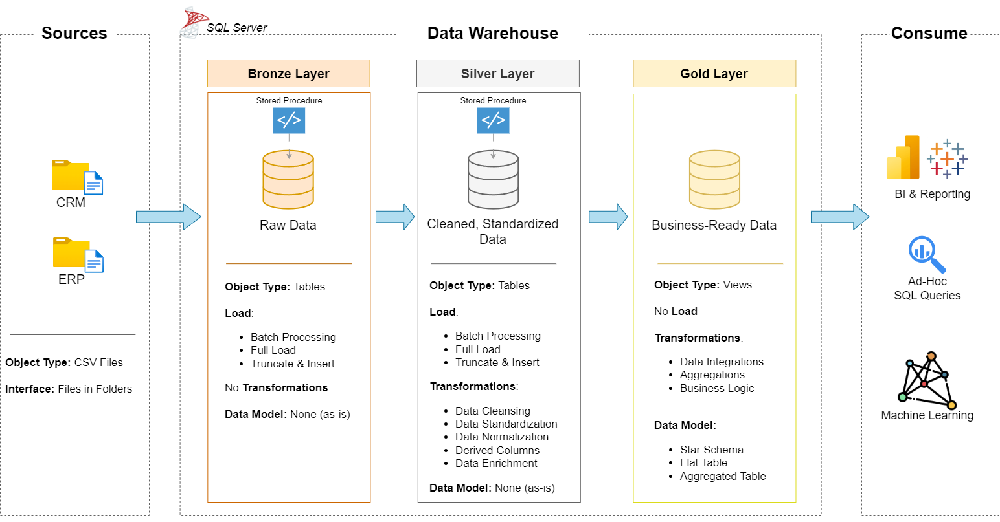
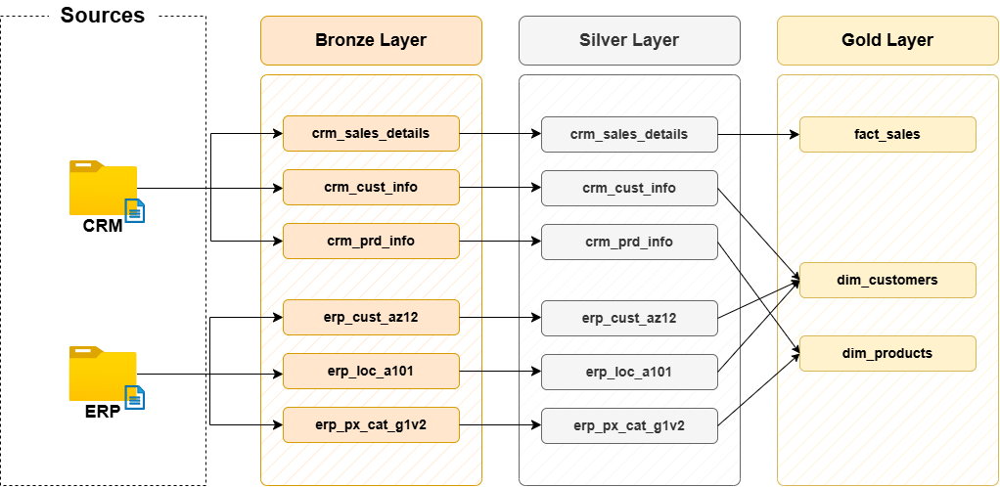

# SQL Data Warehouse Project

An end-to-end data warehouse on **Microsoft SQL Server**, built with a Medallion architecture (Bronze, Silver, Gold). It loads raw CRM and ERP data, cleans and integrates it with T-SQL, and exposes a star schema ready for BI reporting.

## 📌 Executive Summary

Organizations that depend on data at scale need reliable, well-structured data warehouses to support business intelligence and analytical decision-making. This project consolidates customer, product, and sales data from two source systems into a single analytical model, covering three areas:

- **Data architecture:** A three-layer design (Bronze, Silver, Gold) based on the Medallion pattern.
- **ELT pipelines:** Bulk-loading CSV source files into SQL Server and transforming the data in place, layer by layer.
- **Data modeling:** A star schema of fact and dimension views built for reporting.

## 🧰 Skills Demonstrated

T-SQL · Stored procedures · Window functions · Data profiling and cleansing · Data aggregation and enrichment · Data integration · Dimensional modeling (star schema) · ELT pipeline design · Data quality validation

## 💎 Project Requirements

### Objective

Develop a modern data warehouse using SQL Server to consolidate sales data, enabling analytical reporting and informed decision-making.

### Specifications

- **Data sources:** Import data from two source systems (CRM and ERP) provided as CSV files.
- **Data quality:** Cleanse and resolve data quality issues prior to analysis.
- **Integration:** Combine both sources into a single, user-friendly data model designed for analytical queries.
- **Scope:** Focus on the latest dataset only; historization of data is not required.
- **Documentation:** Provide clear documentation of the data model to support both business stakeholders and analytics teams.

## 🏗 Data Architecture & Data Flow

The architecture follows the **Medallion pattern**. Data is extracted from **Customer Relationship Management (CRM)** and **Enterprise Resource Planning (ERP)** systems as CSV files and moves through three layers:



| Layer | Schema | Purpose | Transformations |
|-------|--------|---------|-----------------|
| **Bronze (Raw)** | `bronze` | Staging tables that mirror the source schemas, loaded with `BULK INSERT` (truncate and load) | None; original formats are preserved |
| **Silver (Cleaned & Standardized)** | `silver` | Cleansed, transformed, and standardized data | Deduplication, trimming, data standardization, handling missing values, enforcing business rules |
| **Gold (Analytical)** | `gold` | Business-ready star schema exposed as views, optimized for BI reporting | Joins across CRM and ERP, surrogate key generation, business logic |

### Data Flow and Integration

The diagram below shows how source tables flow from Bronze to Gold and how CRM and ERP data are joined.



## 📂 Repository Structure

```
sql-data-warehouse-project/
├── datasets/                 # Source data files (CSVs)
├── docs/                     # Requirements, ERDs, diagrams, and other documentation
├── scripts/
│   ├── init_database.sql     # Database creation and schema initialization
│   ├── bronze/               # DDL and ingestion scripts for the raw layer
│   │   ├── ddl_bronze.sql
│   │   └── proc_load_bronze.sql
│   ├── silver/               # Transformation and data quality scripts
│   │   ├── ddl_silver.sql
│   │   └── proc_load_silver.sql
│   └── gold/                 # Dimensional model views
│       └── ddl_gold.sql
├── tests/                    # Data quality validation scripts
├── .gitignore
├── LICENSE
└── README.md
```

Further documentation and ERDs are in the [`docs/`](docs/) folder.

## 📐 Data Modeling (Star Schema)

The Gold layer is modeled as a **star schema** for fast analytical queries and straightforward integration with BI tools.

- **Dimensions**
  - `gold.dim_customers`: Unified view of customer profiles and demographics, combining CRM and ERP data.
  - `gold.dim_products`: Catalog of products, categories, subcategories, and pricing.
- **Facts**
  - `gold.fact_sales`: Transaction-level sales events capturing sales amounts, quantities, and foreign keys to the dimensions.

## 📊 Example Output

**Query:**

```sql
-- Example: total sales by product category
SELECT
    p.category,
    SUM(f.sales_amount) AS total_sales
FROM gold.fact_sales f
LEFT JOIN gold.dim_products p
    ON f.product_key = p.product_key
GROUP BY p.category
ORDER BY total_sales DESC;
```
**Result:**

| category    | total_sales |
|-------------|-------------|
| Bikes       |  28,316,272 |
| Accessories |     700,262 |
| Clothing    |     339,716 |

## 🚀 Getting Started

### Prerequisites

- **Database:** [SQL Server 2022 Express](https://www.microsoft.com/en-us/sql-server/sql-server-downloads)
- **Client tool:** [SQL Server Management Studio (SSMS)](https://learn.microsoft.com/en-us/sql/ssms/download-sql-server-management-studio-ssms)
- **Optional:** [draw.io](https://www.drawio.com/), to view or edit the architecture diagrams

### Step-by-Step Setup

1. **Clone the repository:**
   ```
   git clone https://github.com/czarks-dataworks/sql-data-warehouse-project.git
   cd sql-data-warehouse-project
   ```
2. **Initialize the database and schemas:** Open SSMS, connect to your SQL Server, and run `scripts/init_database.sql` to create the database and the `bronze`, `silver`, and `gold` schemas.

   > ⚠️ **Warning:** This script drops and recreates the database if it already exists. Do not run it against a database you want to keep.

3. **Deploy the Bronze layer:**

   - Run `scripts/bronze/ddl_bronze.sql` to create the staging tables.
   - Run `scripts/bronze/proc_load_bronze.sql` to create the load procedure.
   - Update the CSV file paths in `proc_load_bronze.sql` to match the location of the `datasets/` folder on your machine. `BULK INSERT` requires absolute paths, and the file must be readable by SQL Server.
   - Run the procedure:

     ```sql
     EXEC bronze.load_bronze;
     ```

4. **Transform to the Silver layer:**

   - Run `scripts/silver/ddl_silver.sql` to create the cleaned table structures.
   - Run `scripts/silver/proc_load_silver.sql` to create the procedure that transforms and standardizes Bronze data.
   - Run the procedure:

     ```sql
     EXEC silver.load_silver;
     ```

5. **Build the Gold layer:**

   - Run `scripts/gold/ddl_gold.sql` to create the star schema views (`gold.dim_customers`, `gold.dim_products`, and `gold.fact_sales`).
   - Verify the output:

     ```sql
     SELECT TOP 10 * FROM gold.dim_customers;
     SELECT TOP 10 * FROM gold.dim_products;
     SELECT TOP 10 * FROM gold.fact_sales;
     ```

## 🛡️ Data Quality & Validation

SQL validation scripts in the [`tests/`](tests/) folder are run after the Silver and Gold loads. They check for:

- Primary key uniqueness and nullability (`IS NULL` checks, `GROUP BY ... HAVING COUNT(*) > 1`)
- Out-of-range numeric values and date anomalies
- Unwanted spaces and inconsistent values in text fields
- Foreign key referential integrity between facts and dimensions

### Sample issues found and resolved

| Issue | Where | Resolution |
|-------|-------|------------|
| Duplicate customer IDs | CRM customer table | Kept the most recent record per customer |
| Invalid or out-of-range dates | CRM product table, ERP customer table | Applied the data handling rules specified in the course; business logic was applied to values that the rules did not cover |
| Inconsistent gender and country values | CRM and ERP customer tables | Standardized to full, consistent values |
| Inconsistent sales amount, quantity, and price | CRM sales table | Recomputed sales or price per row from the other fields, following the business rules |

## 🙌 Credits & Revisions

[](https://github.com/DataWithBaraa/sql-data-warehouse-project)

This project follows the guided [SQL Data Warehouse Project](https://github.com/DataWithBaraa/sql-data-warehouse-project) from the Data With Baraa SQL course, which provides the datasets and the overall design.

The course presumes consultation with source data experts to define data transformation rules, particularly in the `silver layer`. As this was a learning exercise, I followed the rules given in the course and applied my own business logic where they were silent.

Revisions were made in the scripts and diagrams to address typos and a few minor issues. Comments in the scripts were added or modified for specificity and clarity.

A major correction was made in the [silver layer stored procedure (table 6 of 6)](scripts/silver/proc_load_silver.sql) that was not covered by the guided project: one id in the ERP product table differed by one letter from its CRM equivalent. It was transformed using CASE-WHEN (`'CO_PD'` -> `'CO_PE'`).

## 📜 License

This project is licensed under the [MIT License](LICENSE). The original copyright notice from the source project is retained alongside mine.

## 👨‍💻 About Me

I am **Czarks**, an analytics professional with over a decade of experience using organizational data to understand and solve operational problems in banking and government. I am expanding my toolkit to include modern data tools such as SQL, and I am targeting BI and analytics engineering roles. I enjoy turning raw, messy data into clean, business-ready insights.

- **GitHub:** [@czarks-dataworks](https://github.com/czarks-dataworks)
- **LinkedIn:** [Czarina Besares](https://www.linkedin.com/in/czarinabesares/)

Feel free to connect, or drop a star ⭐ if you found this project helpful.
